# Offixia product gallery

These captures use a deleted demo organization, fictional people, and sample
content. Invite codes shown here are no longer active.

## Daily operations

<table>
  <tr>
    <td>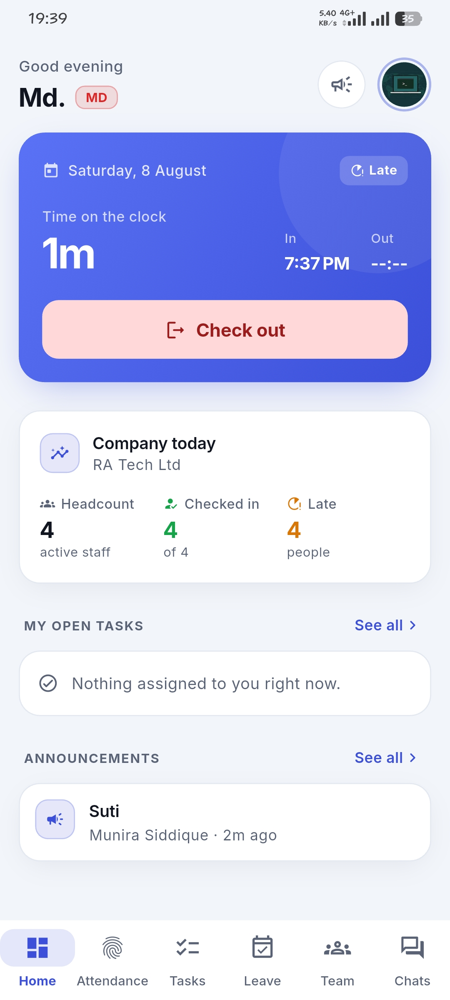</td>
    <td>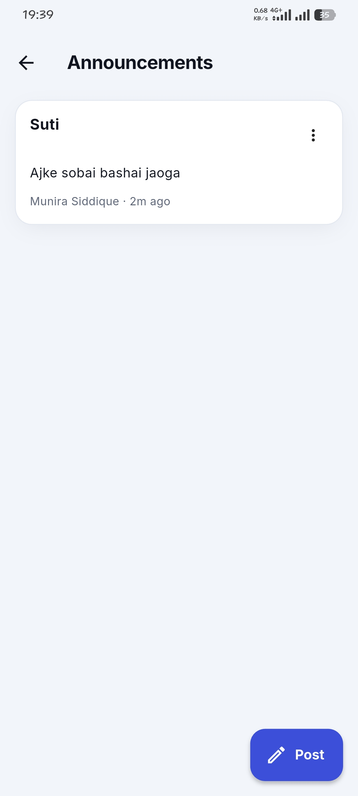</td>
    <td>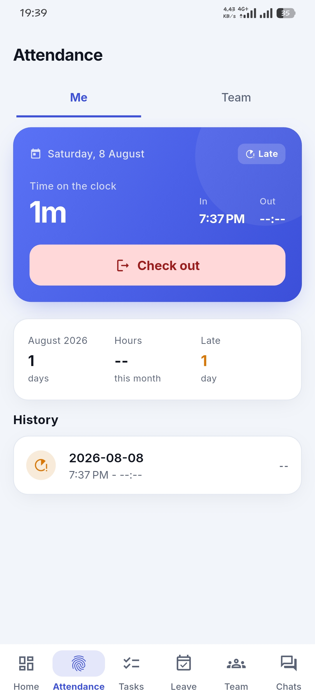</td>
  </tr>
  <tr>
    <td align="center"><strong>Dashboard</strong></td>
    <td align="center"><strong>Announcements</strong></td>
    <td align="center"><strong>Personal attendance</strong></td>
  </tr>
  <tr>
    <td>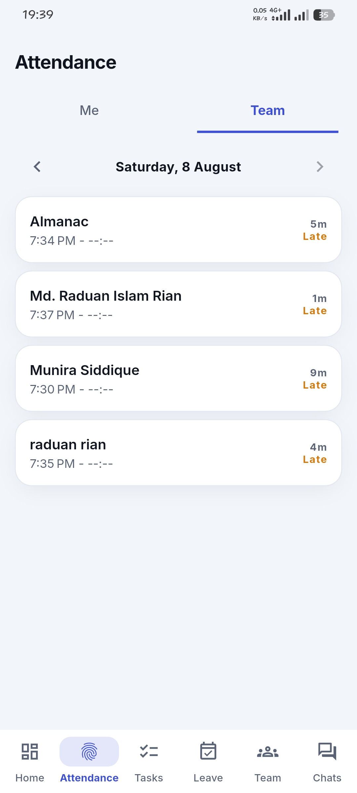</td>
    <td>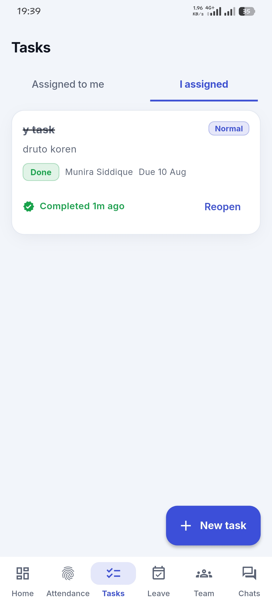</td>
    <td></td>
  </tr>
  <tr>
    <td align="center"><strong>Team attendance</strong></td>
    <td align="center"><strong>Tasks</strong></td>
    <td align="center"><strong>Leave approvals</strong></td>
  </tr>
</table>

## People and teams

<table>
  <tr>
    <td>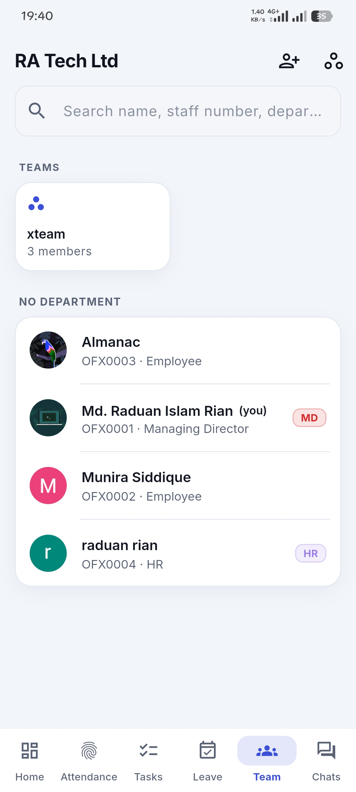</td>
    <td>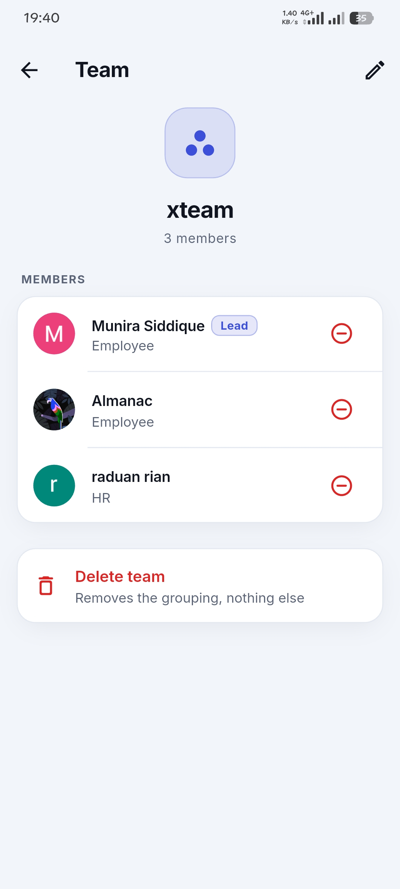</td>
    <td>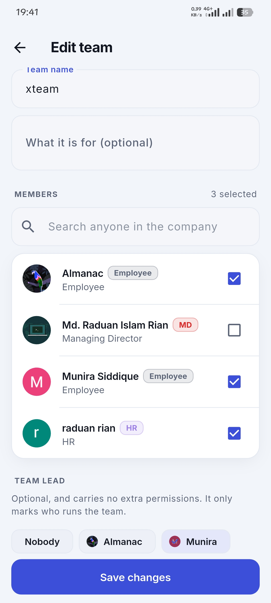</td>
  </tr>
  <tr>
    <td align="center"><strong>Directory</strong></td>
    <td align="center"><strong>Team details</strong></td>
    <td align="center"><strong>Team editor</strong></td>
  </tr>
  <tr>
    <td>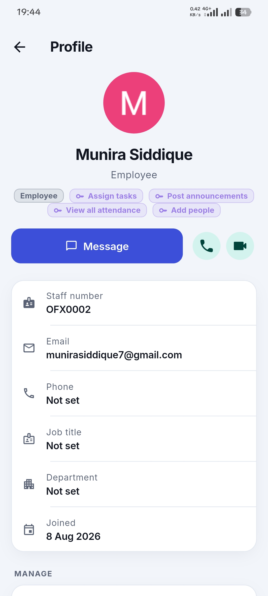</td>
    <td>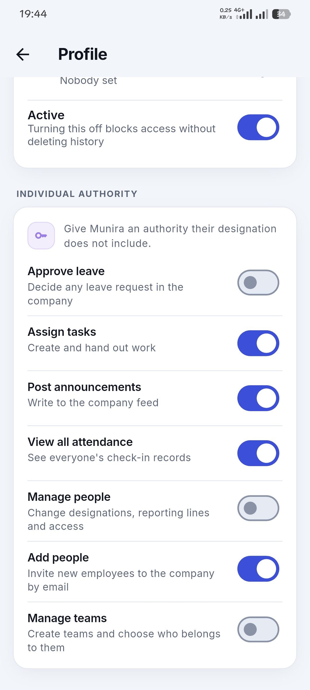</td>
    <td>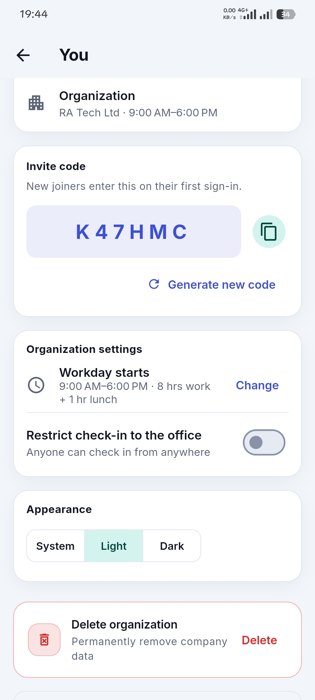</td>
  </tr>
  <tr>
    <td align="center"><strong>Employee profile</strong></td>
    <td align="center"><strong>Individual authority</strong></td>
    <td align="center"><strong>Organization settings</strong></td>
  </tr>
</table>

## Messaging and calls

<table>
  <tr>
    <td>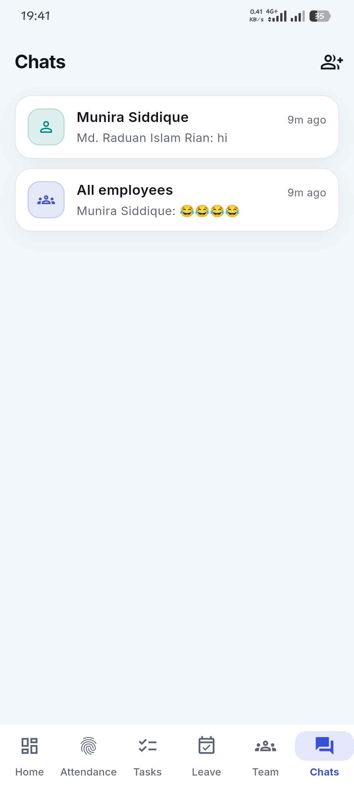</td>
    <td></td>
    <td>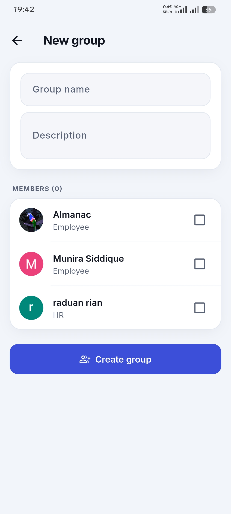</td>
  </tr>
  <tr>
    <td align="center"><strong>Conversations</strong></td>
    <td align="center"><strong>Direct chat</strong></td>
    <td align="center"><strong>Create a group</strong></td>
  </tr>
  <tr>
    <td></td>
    <td></td>
    <td></td>
  </tr>
  <tr>
    <td align="center"><strong>Group chat</strong></td>
    <td align="center"><strong>Group call</strong></td>
    <td align="center"><strong>Direct call</strong></td>
  </tr>
</table>

## Organization entry

<table>
  <tr>
    <td>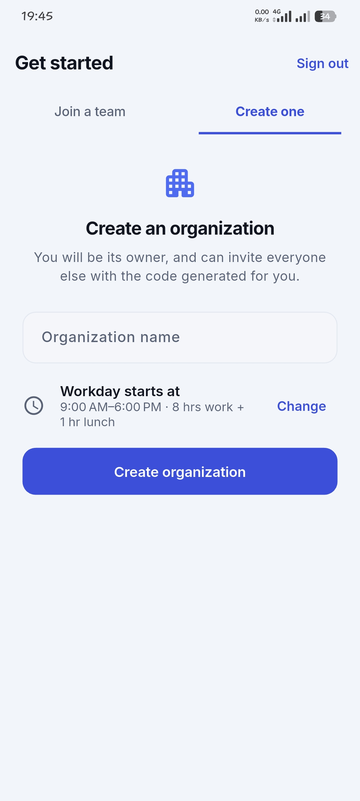</td>
    <td></td>
  </tr>
  <tr>
    <td align="center"><strong>Create an organization</strong></td>
    <td align="center"><strong>Join an organization</strong></td>
  </tr>
</table>
